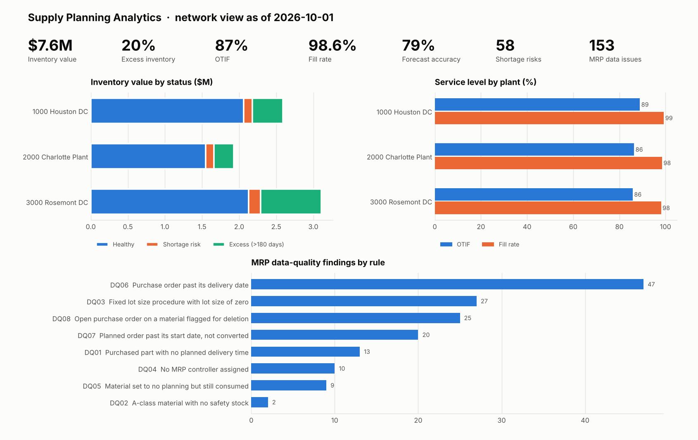

# Supply Planning Analytics: MRP Data Quality, Inventory KPIs & Demand Forecast

Supply planning analytics on SAP S/4HANA-shaped data: material availability and days of supply, MRP data-quality checks that catch the master-data problems behind MRP failures, a plant KPI scorecard (inventory, OTIF, fill rate, forecast accuracy), a backtested demand forecast, and a Power BI model ready to load.

> All data is synthetic, generated by `scripts/generate_data.py`. Tables and fields use SAP names (MARA, MARC, MARD, MBEW, EKPO/EKET, PLAF) so the logic reads the way it would on a live S/4HANA system. No real Honeywell or SAP data is used.



## What it answers

| Planner question | Where |
|---|---|
| Which materials will run short before their next receipt? | `zc_materialavailability`: projected stock at end of lead time vs safety stock |
| Where is cash tied up in excess stock? | Days of supply and excess value (>180 days) by plant |
| Which master-data problems will make MRP plan wrong? | `mrp_dq_issues`: 8 rules, each with severity and a plain-English fix |
| How reliable are suppliers and the plan? | Overdue POs, past-due planned orders |
| Are we serving customers? | OTIF and fill rate by plant |
| How much demand is coming? | 3-month forecast per material and plant, with backtested accuracy |

## Results from the sample run (as of 2026-10-01)

| Plant | Inventory | Excess | Days of supply | Shortage risks | OTIF | Fill rate | Overdue POs | DQ-clean | Forecast accuracy |
|---|---:|---:|---:|---:|---:|---:|---:|---:|---:|
| 1000 Houston DC | $2.59M | 15.7% | 65 | 19 | 88.9% | 99.3% | 10.8% | 60.4% | 82.4% |
| 2000 Charlotte Plant | $1.95M | 13.8% | 55 | 17 | 86.4% | 98.5% | 14.8% | 59.3% | 76.8% |
| 3000 Rosemont DC | $3.11M | 26.2% | 60 | 22 | 85.8% | 98.1% | 6.6% | 68.1% | 79.2% |

Findings a planner would act on:

- **Rosemont carries the most excess:** 26% of its inventory value is more than 180 days of supply, almost double the other plants.
- **153 MRP data-quality findings across 122 material-plant records.** The most damaging are 13 purchased parts with no planned delivery time (MRP orders them too late) and 27 fixed-lot-size records with a lot size of zero (MRP can't create the order).
- **58 materials at risk of shortage** within their lead time, sorted into a work list by ABC class and size of the gap.
- **Model selection lifts forecast accuracy from 74.3% to 79.5%** over the "next month equals last month" benchmark, weighted by volume.

## How it works

```
data/ (SAP-shaped extracts)
   │
   ▼
python/run_pipeline.py
   ├─ load → SQLite
   ├─ python/forecast.py ── 4 methods per series, 6-month backtest, best by WAPE, 3-month forecast
   ├─ sql/02_planning_views.sql ── ZI_ interface views → ZC_MaterialAvailability
   ├─ sql/03_mrp_data_quality.sql ── 8 MRP data-quality rules → mrp_dq_issues
   ├─ sql/04_kpis.sql ── plant KPI scorecard + planner work list
   └─ exports ── powerbi/data/ (star schema) + docs/dashboard_preview.png
```

### MRP data-quality rules

| Rule | Check | Severity | Why MRP cares |
|---|---|---|---|
| DQ01 | Purchased part with no planned delivery time | High | Orders get placed too late |
| DQ02 | A-class material with no safety stock | High | No buffer on the most critical parts |
| DQ03 | Fixed lot size procedure with lot size of zero | High | MRP can't create a valid order |
| DQ04 | No MRP controller assigned | Medium | Exception messages reach no one |
| DQ05 | Set to no planning but still consumed | High | Demand MRP will never cover |
| DQ06 | Purchase order past its delivery date | Medium | MRP counts supply that hasn't arrived |
| DQ07 | Planned order past start date, not converted | Medium | Plan is stale |
| DQ08 | Open PO on a material flagged for deletion | Low | Buying a discontinued part |

The generator plants 138 known problems, and the tests confirm **every one is caught** and that the master-data rules flag **nothing else**.

### Forecasting

Each material-plant series (24 months) is backtested on a 6-month holdout with four methods: naive, 3-month moving average, simple exponential smoothing (alpha tuned per series), and seasonal naive. The lowest-WAPE method is refit on the full history and projects 3 months ahead. That forecast drives daily demand in the availability view, so shortage risk reflects where demand is heading, not just where it's been.

## Power BI

`powerbi/data/` holds a star schema: `dim_plant`, `dim_material_plant`, and facts for availability, data-quality issues, demand (actual and forecast) and deliveries. [`powerbi/MODEL.md`](powerbi/MODEL.md) gives the relationships and a four-page report layout, and [`powerbi/measures.dax`](powerbi/measures.dax) has the DAX measures: inventory value, excess %, weighted days of supply, OTIF %, fill rate %, DQ clean %, and demand trend.

## SAP S/4HANA context

The SQL views follow the CDS layering used for S/4HANA embedded analytics: `ZI_` interface views over base tables, `ZC_` consumption views for reporting. [`docs/cds_mapping.md`](docs/cds_mapping.md) maps each view to its SAP tables and released views, with an example ABAP CDS view entity. [`docs/data_dictionary.md`](docs/data_dictionary.md) explains every field and derived measure.

## Run it

Requires Python 3 with NumPy and matplotlib.

```bash
python3 scripts/generate_data.py          # synthetic data (already included)
python3 python/run_pipeline.py            # full run: forecast, views, DQ, KPIs, Power BI exports
python3 -m unittest discover -s tests -v  # 11 tests
```

## Repository layout

```
data/        SAP-shaped extracts + list of injected data problems
scripts/     data generator
sql/         01 tables · 02 planning views · 03 MRP data quality · 04 KPIs
python/      pipeline runner · forecasting · dashboard preview
powerbi/     star-schema CSVs · DAX measures · model and report guide
docs/        data dictionary · CDS mapping · dashboard preview
tests/       end-to-end tests
```
